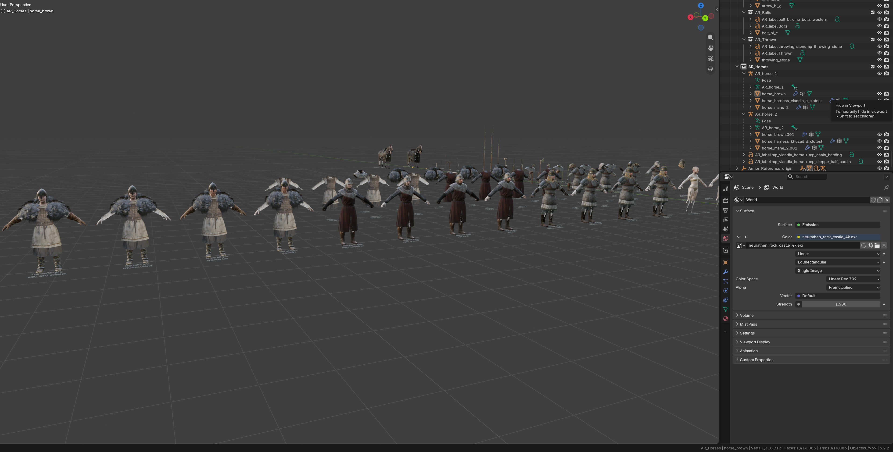

# Bannerlord Reference (Blender)

Blender 4.4 reference files rebuilt from Mount & Blade II: Bannerlord's own scene and prefab data, for modders who want to
modify, measure or block out Bannerlord-style architecture and scenes in Blender.

- **Guides:** 16 community guides on 3D art and scene building, compiled from six years of the Mount & Blade Modding Discord with every finding credited. They live in the [Bannerlord Scene Toolkit repo](https://github.com/fiefevictionnotice/BannerlordSceneToolkit/tree/main/guides).
- **Skeleton and bodies:** the human skeleton (with male body) FBX and the male/female body reference meshes are in [community-pins/reference-meshes/](community-pins/reference-meshes/).




## Download

The files are large (about 15.6 GB with full-resolution textures), so they are hosted on the Internet Archive, not in this repository:

**https://archive.org/details/bannerlord-reference-blender**

The package is nine separate 7-Zip archives, plus an optional tenth with the Armor Reference. Download the ones you want into one folder and extract each one **into that same
folder** with [7-Zip](https://www.7-zip.org/) (free); their contents interleave into a single `Bannerlord-Reference-Distribution`
tree (blends at the top, textures under `deps\textures\`). Open the extracted `.blend` files in Blender 4.4.

| Archive | Size | Contents | MD5 |
|---|---|---|---|
| `Bannerlord-Reference-01-Blends-Tools.7z` | 2.1 GB | all five `.blend` files, docs, license, `tools\`, asset catalog. **Required.** | `e0626adda0c0593e831f001ae8c1d11f` |
| `Bannerlord-Reference-02-Textures-Architecture-Empire.7z` | 1.7 GB | Empire building textures | `5f67bf5393dc8881c2a0c5eb32e8c629` |
| `Bannerlord-Reference-03-Textures-Architecture-Shared.7z` | 1.6 GB | shared building textures (used by every culture) | `ff8e7b5bbdb3c5e167a26b1e3207aac6` |
| `Bannerlord-Reference-04-Textures-Architecture-Cultures-Extra.7z` | 0.8 GB | Vlandia, Battania, Sturgia, Khuzait, Aserai building textures + misc | `112cf5e17871cd78e8f525db08a00df1` |
| `Bannerlord-Reference-05-Textures-DLC-A.7z` | 2.0 GB | War Sails DLC textures, part A | `e5b81b9e0a3172776154a50c328dd341` |
| `Bannerlord-Reference-06-Textures-DLC-B.7z` | 2.0 GB | War Sails DLC textures, part B | `6012e207b81e951908f33267f9d13236` |
| `Bannerlord-Reference-07-Textures-Nature.7z` | 2.2 GB | terrain, rock, cliff and plant textures | `4671cc178ca8f49ff83e2451914a42b1` |
| `Bannerlord-Reference-08-Textures-Equipment.7z` | 1.4 GB | equipment textures referenced by props | `0567daa0e19e88b3492e376290870a07` |
| `Bannerlord-Reference-09-Textures-Shared-Props.7z` | 1.8 GB | shared and prop textures | `22e459c0665df990f419b243d5046403` |
| `Bannerlord-Reference-10-Armor-Reference.7z` | 1.1 GB | **optional extra, self-contained:** the Armor Reference blend and its own textures. See "Armor reference" below. | `b3bf421fbe592acec8a767b530f32066` |

Archive 01 works on its own (meshes, hierarchy and material names are all there); anything whose textures you have not
downloaded just shows as flat colour. The same MD5 list is in `CHECKSUMS.md5` on the archive page.

This repository holds the documentation, the license, the texture-downscale script, the one blend small enough to live here
(`Bannerlord-Physics-Materials.blend`, 160 KB, no textures; see "Physics materials" below) and the polycount reference
(see "Polycount reference" below). Everything else is in the archive.

Everything here is derived from TaleWorlds' game assets (Native and the Naval DLC). See LICENSE.md for what that means.

## What's in the folder

| File | Contents |
|---|---|
| `Bannerlord-Reference-Buildings.blend` | 1,600+ Native and Naval DLC building prefabs, one collection per culture (Empire, Vlandia, Aserai, Khuzait, Sturgia, Nord, Battania, Shared), sub-divided into Walls, Towers & Gates, Keeps, Houses, Farm & Utility, Misc, Modular, DLC. Every prefab keeps its in-game entity hierarchy (Empty per entity, meshes underneath). |
| `Bannerlord-Prop-Production-Buildings.blend` | The same set on a plain working scene. |
| `Bannerlord-Scene-empire_village_a.blend` | The Native village scene `empire_village_a` rebuilt entity by entity, with its terrain heightmap and paint layers. |
| `Bannerlord-Mesh-Library.blend` | Every mesh the files above use, one prototype object each, sorted into `Lib_<Culture>` collections. The other files append from it. |
| `Bannerlord-Physics-Materials.blend` | The 41 physics materials from the game's `physics_materials.xml` (`stone`, `wood`, `wood_nonstick`, `adobe`, `metal`, ...) as Blender asset materials, colour-coded with the engine's own display colours, with friction / arrows-stick / flammable notes in the description. No textures. See "Physics materials" below. |
| `Bannerlord-Physics-Shape-Polycounts.md` (+ two `.tsv`) | Triangle counts of every Native and Naval DLC physics shape, paired with the LOD0 render mesh it belongs to. In this repository only, not in the archives yet. See "Polycount reference". |
| `blender_assets.cats.txt` | Asset catalog file for the line above. Only needed if you register this folder as an asset library. |
| `deps\textures\...` | Only the textures the blends reference, at native resolution, in the same folder layout as the material library they came from. |
| `tools\` | `Relocate-BannerlordReference.ps1` (+ `bl_relocate.py`, `texconv.exe`): makes a copy of this folder with every texture downscaled to a size you choose. See "Optional: lighter textures". |

## Installing

You need Blender 4.4 (or newer 4.x) installed. Nothing else.

Extract the archives into one folder and open the `.blend` files. All texture paths are relative, so the folder works from
any location as long as you keep it together (the blends, `deps\` and `tools\` side by side). Move or copy it with Explorer
whenever you like; nothing inside needs updating.

## Optional: lighter textures

The textures ship at native resolution, many at 4k and 8k. That is why the package is 15 GB, and why Material Preview on a
whole culture can exhaust an ordinary GPU. `tools\Relocate-BannerlordReference.ps1` makes a **downscaled copy** of the
folder: it copies everything to a destination, runs every texture through `texconv.exe` at the size you choose, and rewrites
the paths inside the copied blends to match. The folder you started from is not touched.

1. Open PowerShell in this folder (Shift + right-click the folder background > "Open PowerShell window here", or type
   `powershell` in the folder's address bar).
2. Run one of:

   ```powershell
   # copy to D:\Blender\Bannerlord-Reference with every texture capped at 2048 px (about a quarter of the size)
   .\tools\Relocate-BannerlordReference.ps1 -Destination "D:\Blender\Bannerlord-Reference" -MaxTexture 2048

   # 1024 px is plenty for blocking out and fits almost any GPU
   .\tools\Relocate-BannerlordReference.ps1 -Destination "D:\Blender\Bannerlord-Reference" -MaxTexture 1024
   ```

3. Wait for the `done ->` line. The script finds Blender itself; if it can't, pass `-Blender "C:\path\to\blender.exe"`.

Without `-MaxTexture` the script only makes a verified full-size copy (or, with `-Move`, moves the folder and deletes the
source once every path checks out). Explorer does that job just as well, so the switch is the reason to run it.

If Windows refuses to run the script ("running scripts is disabled on this system"), start it as
`powershell -ExecutionPolicy Bypass -File .\tools\Relocate-BannerlordReference.ps1 ...` instead; nothing else changes.

## Using the files

* Collections are **disabled** (unticked in the outliner) by default so a file opens fast. Tick a culture or category on to see it.
* Every prefab is an Empty named after the prefab; its parts are parented underneath. Move the Empty, not the parts.
* Objects carry custom properties: `bl_mesh` (engine mesh name), `bl_prefab` (prefab the entity instanced), `bl_bend_amount` /
  `bl_bend_center` on entities that use the engine's mesh bender (they also get a SimpleDeform modifier as an approximation).
* Objects named `BEND~...` carry the mesh bender; objects tagged `bl_sheared` have a sheared engine transform baked into a mesh copy.
* Materials use the engine material names, so an FBX export links back to the game's materials in the Modding Kit editor.
* Material Preview on a whole culture at once loads a lot of 4k/8k textures. Enable one category at a time, or set
  Preferences > Viewport > Textures > Limit Size to 2048.

## Armor reference

The screenshot above is `Bannerlord-Armor-Reference.blend`, a ready-made reference for armor and equipment work, built
from Native's multiplayer items. It is not in this repository: download **`Bannerlord-Reference-10-Armor-Reference.7z`**
(1.1 GB) from the [Internet Archive page](https://archive.org/details/bannerlord-reference-blender) and extract it with
7-Zip. Open the blend in Blender 4.4 or newer.

What's in it (one collection, `Armor_Reference`):

* `human_skeleton` on its own, and base male and female bodies (body, head, hands).
* Three multiplayer armor sets (Empire, Vlandia, Sturgia), each worn by four rigged figures: male, male with gloves,
  female, female with gloves (helmet, body armor, cape, gloves or bare hands, boots).
* Every equipment slot as loose parts, including all four body-armor variants the game switches between:
  `<mesh>` (male), `<mesh>_slim` (male with gloves, narrower sleeves), `<mesh>_converted` (female fit) and
  `<mesh>_converted_slim` (female with gloves).
* 26 multiplayer weapons (swords, one- and two-handed axes, throwing axes, javelins, jereeds, maces, a dagger, polearms,
  pikes), assembled from their crafting pieces with the game's own placement rule. Also shields, bows, crossbows, ammo
  and two horses with harness.

**How it relates to the material files.** Archive 10 is self-contained. It carries the 133 textures it uses, so you do
not need archives 01-09 for it. Those textures sit in the same `deps\textures\` layout as the rest of the package, and the
materials use the same engine names and node setup as the material files there. So you can also extract it **into the same
folder** as archives 01-09. 21 textures are shared with those archives and are byte-identical, so if 7-Zip asks
about overwriting, either answer is fine. Because the material names match the engine, a mesh built with them links back
to the game's own materials on import in the Modding Kit.

Characters face +Y, the engine's forward direction: use the back view (Ctrl+Numpad1) to see their faces and read the
labels. Before exporting armor rigged to these skeletons, read the
[rigged armor guide](https://github.com/fiefevictionnotice/BannerlordSceneToolkit/blob/main/guides/03-rigged-armour-helmets-gloves.md)
(skeleton named `human_skeleton_notused`, Skinning ticked, no leaf bones, at most 4 weights per vertex).
`README-Armor-Reference.md` on the archive page and inside the archive has the details.

## Physics materials

Bannerlord picks the physics material of a collision mesh (`bo_<name>`) from the **name of the material** on it: a face with a
material called `stone` becomes stone, `wood_nonstick` becomes wood that arrows don't stick to, and any name the engine does not
know silently falls back to `default`. So the trick is just to spell the names right.

`Bannerlord-Physics-Materials.blend` gives you every valid name as a drag-and-drop asset:

1. Preferences > File Paths > Asset Libraries > `+`, pick this folder (or open the blend and append the materials you need).
2. In the Asset Browser choose *Bannerlord Native > Physics Materials*.
3. Select the `bo_` object, Edit Mode, select the faces of one part, drag the material onto the mesh. Use *Append (Reuse Data)*
   so a second use does not create `stone.001` (the `.001` would break the match).
4. Repeat per part and export. In the Modding Kit, switch on the physics display to check: each part shows the material's colour,
   the same colours these assets use in Solid view. Anything in the `default` colour has a name the engine did not recognise.

The materials are plain flat colours, only their names matter. Weapon / shield / missile entries (`metal_weapon`, `wood_shield`,
`missile`, ...) are for items, not scene props.

## Polycount reference

How heavy are Native's own meshes and collision shapes? [`Bannerlord-Physics-Shape-Polycounts.md`](Bannerlord-Physics-Shape-Polycounts.md)
has the summary tables and rules of thumb; the two TSVs have one row per mesh, for sorting and filtering in a spreadsheet:

* [`Bannerlord-LOD0-vs-Physics-Polycounts.tsv`](Bannerlord-LOD0-vs-Physics-Polycounts.tsv): 6,302 render meshes that have a
  `bo_` shape of the same name, with LOD0 triangles, LOD count, lowest-LOD triangles, physics triangles, capsule/sphere
  primitives, physics as a percentage of LOD0, and LOD0 size in meters.
* [`Bannerlord-Physics-Shape-Polycounts.tsv`](Bannerlord-Physics-Shape-Polycounts.tsv): all 7,871 physics shapes with
  manifold, vertex and face counts and their physics materials.

In short: collision is a median 5.6% of LOD0 (buildings 2-8%, rocks and cliffs about 25%), trees mostly use capsules, and the big
keep/house interiors ship as a single LOD of 30k-214k triangles. Read with TpacTool from game 1.4.8.

## How to import your first asset

The short version of getting something you built in Blender into the Modding Kit editor, with materials, LODs and
collision set up automatically on import instead of by hand afterwards. It assumes you already have a module folder
(`Modules\<YourModule>\` with a `SubModule.xml`) and that its `Assets\` folder exists.

**1. Prepare the mesh in Blender.** The importer reads everything it needs from names, so get the names right before you export:

* **Materials.** Give every material the exact name of the engine material you want (`empire_wall_a`, `roman_brick_b`, `nord_rock_set01`
  and so on, the same names you see on the reference meshes). On import the editor links a material with a known name to the
  game's own material, textures and shader flags included. A name the engine does not know becomes an empty placeholder
  material you would have to set up yourself.
* **LODs.** Put the lower-detail versions in the same file, named `<mesh>.lod1`, `<mesh>.lod2`, ... (`my_wall`, `my_wall.lod1`,
  `my_wall.lod2`). The importer groups them as LOD levels of `my_wall`. Two or three levels are enough for a building piece;
  anything scattered in the hundreds (rocks, cliffs) wants more. The simplest way to make progressively simpler LODs (lower
  detail as you get to the higher LOD) is a progressively higher decimate value with a modifier. Manual cleanup will typically
  still be required for the best results. 
* **Collision.** Add a simple mesh named `bo_<mesh>` (`bo_my_wall`). That prefix makes it the physics shape instead of a
  visible mesh. Keep it low-poly and closed (Native collision is typically about 5% of LOD0's triangle count, see
  "Polycount reference"). The **material names on the collision faces** set the physics materials
  (`stone`, `wood`, `adobe`, ...); use `Bannerlord-Physics-Materials.blend` for the valid names, see "Physics materials" above.
* **Transform.** Work in metres with the origin where you want the pivot, apply rotation and scale, and keep Z up.

**2. Export.** File > Export > FBX, selected objects only, with the visible mesh, its LODs and the `bo_` mesh selected.
Use Apply Scalings = FBX All so the file arrives at 1:1. Leave animation and armature off for a static prop.

**3. Launch the editor with your module enabled.** In the launcher pick *Modding Kit*, tick your module under Mods, and
start the editor. If the module is not ticked its folder will not appear in the editor at all.

**4. Import.** Click **Resource Browser** in the editor's top toolbar (hover the icons if you are not sure which one).
In the tree, open your module, go into its `Assets` folder, right-click the empty area and choose **Import New Asset**. Pick the
FBX. In the import settings that pop up, keep the mesh and material options on and make sure the physics option is on, then
confirm. The mesh appears in that folder with its LODs and body attached; if a material shows as a plain placeholder,
its name did not match an engine material.

**5. Check it.** Double-click the mesh to open it in the viewer: cycle the LODs, and switch on the physics display to see the
collision shape with each face tinted in its physics material's colour. Anything in the `default` colour has a material name
the engine did not recognise.

**6. Save the asset package.** Save in the Resource Browser (Ctrl+S with it focused). The editor compiles the module's assets
into `Modules\<YourModule>\AssetPackages\<package>.tpac`, which is what the game and other players actually load. An imported
asset that has not been saved is only in the editor's memory.

**7. Use it.** Create a prefab from it (place the mesh in a scene, tidy the entity, right-click > Save as prefab, or add it to
one of your module's `Prefabs\*.xml`) and it becomes a normal prop for scene work. For multiplayer, remember that clients only
load prefabs from Native and from your module, so prefabs saved into SandBoxCore will not show up in a match.

If something imports 100 times too big or lying on its side, the FBX scale or axis settings are the culprit, not the editor;
re-export with the scale and forward/up axes adjusted and import again over the top.

## Community resources

The main written reference for Bannerlord 3D modding is the community wiki [docs.bannerlordmodding.lt](https://docs.bannerlordmodding.lt/) (maintained by Litauen). [community-pins/](community-pins/README.md) indexes the pinned guides and tools from the #bl-3d-art Discord channel, credits each author, and links to the matching wiki pages. It also mirrors the human skeleton FBX and the male/female body reference meshes.

## Related projects

- **[Bannerlord Scene Toolkit](https://github.com/fiefevictionnotice/BannerlordSceneToolkit):** in-editor tools for the Bannerlord scene editor (material and prefab swapping, prefab creation, scene analysis, backups).
- **[Scene Toolkit guides](https://github.com/fiefevictionnotice/BannerlordSceneToolkit/tree/main/guides):** 16 guides compiled from six years of the #bl-3d-art and #bl-scenes Discord channels. They cover materials, meshes and LODs, rigged armour, weapons, cloth and physics, terrain and flora, navmesh, sieges, lighting, multiplayer scenes and the campaign map. Every finding credits its author and links to the original message.

## Known gaps

* A handful of engine materials have no exportable textures and show as flat colour: editor helpers, one water shader, `vineyard_a_animated`.
* Flora painted on terrain (grass, bushes placed by the terrain paint system) is not reproduced.
* The mesh-bender deformation is an approximation (axis and magnitude tuned by eye).

## License and credits

Three parts, three owners; see `LICENSE.md` for the full text:

* **Game assets** (every mesh, texture, material and scene layout): © TaleWorlds Entertainment, from Mount & Blade II:
  Bannerlord and the War Sails DLC. No ownership is claimed here. Use is governed by TaleWorlds' mod terms
  (<https://www.taleworlds.com/en/static/mtla>): non-commercial modding of the game only.
* **The reference layout, reconstruction and this documentation**: CC BY-NC-SA 4.0
  (<https://creativecommons.org/licenses/by-nc-sa/4.0/>). Credit the maintainer, no commercial use, share alike.
* **The scripts in `tools\`**: MIT. `texconv.exe` is Microsoft DirectXTex, MIT, see `THIRD-PARTY-NOTICES.md`.
* **No warranty**: the whole package is provided as is, at your own risk; see section 4 of `LICENSE.md`.

Maintainer: FiefEvictionNotice.

## AI Use Disclaimer

All other sections, all content, etc. was written largely by Claude CLI in Sept. 2026. I may or may not be responsive to issues in the future, but if Taleworlds wants me to pull down this content from GitHub and Archive.org, I'm open to doing that. I haven't made anything available that wasn't already available to the public, it's just more accessible than it would be otherwise. 
